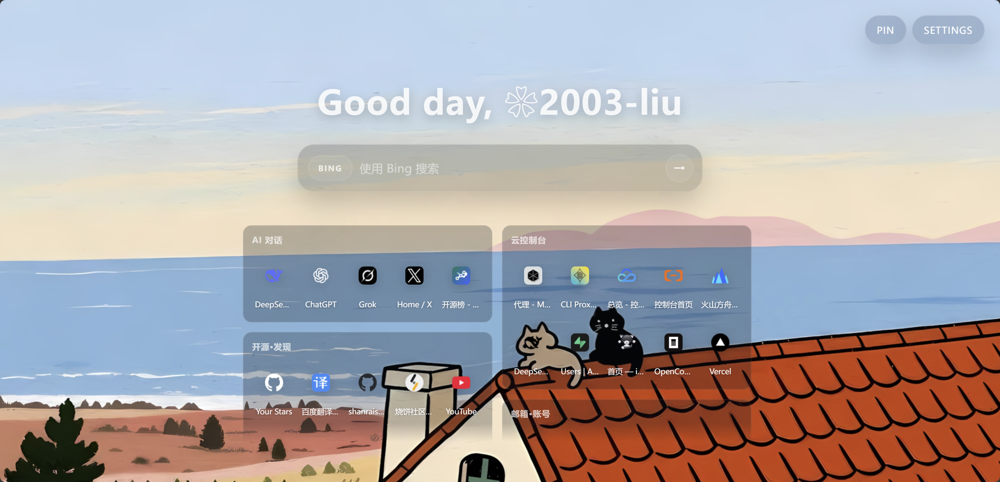

# Simple Tab

> 适用于 Chrome 和 Microsoft Edge 的新标签页扩展，提供书签管理、壁纸和搜索。

[English](README.en.md)



## 功能

- **书签管理**：显示浏览器书签栏及其文件夹。可添加、删除、移动书签，以及新建、重命名和删除分组；删除分组会将其中的书签移回上级文件夹。
- **拖拽整理**：可在分组和未整理区之间移动书签、调整书签位置，并重排分组。分组显示顺序会保存在扩展中；书签编辑写回浏览器。
- **壁纸**：把 PNG、JPG、JPEG、WEBP 或 GIF 图片放进 `wallpapers/`。新标签页会自动发现，支持随机、顺序和固定壁纸。
- **搜索**：支持 Bing、Google 和百度，并提供最近搜索记录。
- **个性化**：可设置显示名称、时间主题和壁纸模式。
- **加载恢复**：书签加载时显示占位效果；读取失败或超时后可重试。

## 安装

1. 下载或克隆本仓库。
2. 在 Chrome 打开 `chrome://extensions/`，或在 Microsoft Edge 打开 `edge://extensions/`。
3. 开启开发者模式，选择“加载已解压的扩展程序”。
4. 选择包含 `manifest.json` 的仓库根目录。
5. 打开新标签页。

扩展会替换浏览器的新标签页，并需要 `storage`、`bookmarks` 和 `favicon` 权限。

## 添加壁纸

将支持的图片放进 `wallpapers/`，新开标签页即可发现，不需要运行同步脚本。

## 开发

需要 Node.js 和 npm。

```bash
npm install
npm run lint
npm test
```

## 项目结构

```text
css/            页面和弹窗样式
js/app.js       应用启动与依赖组装
js/features/    书签、搜索、设置、主题和壁纸功能
js/lib/         浏览器适配、存储、弹窗、偏好和动画
js/ui/          DOM 与展示辅助模块
tests/          Vitest 和 happy-dom 测试
docs/           架构决策与 Agent 文档
```

## 许可

本项目使用 [MIT License](LICENSE)。
